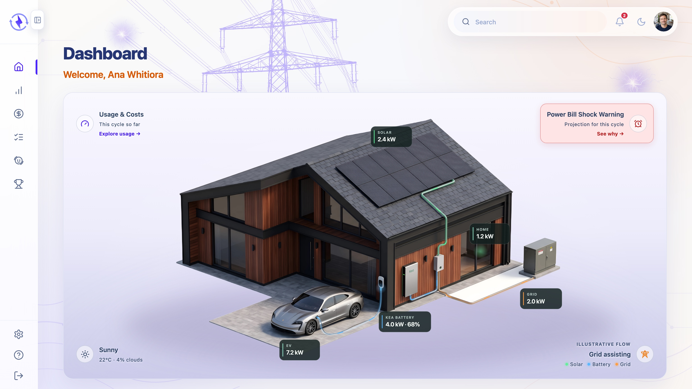

<p align="center">
  
</p>

# Kea Energy — end-to-end testing portfolio

Playwright + TypeScript end-to-end tests for Kea Energy, a University of Auckland Internship team project (2026).

This portfolio demonstrates browser-based functional testing, test-design traceability, defect analysis, automated reporting, and parameterized Jenkins execution against the deployed Kea Energy customer website. It is a standalone test project with its own dependencies; it requires no local application stack and imports no application code.

<p align="center">
  
</p>

## Portfolio baseline — 31 October 2026

The published automation represents the **31 October 2026 baseline**. Across 12 features, all **173 test points (Xmind leaf nodes)** are mapped: **172 automated test points expand into 412 automated test cases**, while one test point requires human answer-quality review. A test point can produce several automated test cases for different accounts or inputs. See [coverage](docs/coverage.md) for the feature mappings and design inventory.

A parameterized Jenkins pipeline supports `smoke`, `regression`, `sparky-live`, and `full` selections and publishes JUnit, Playwright HTML, and Allure reports. See the [Jenkins guide](docs/jenkins.md) for configuration and validation evidence.

### Full AWS regression — 31 October 2026 (including live Sparky)

**413 results including setup: 340 passed, 69 failed, and 4 approved Monthly skips; no retries.**

This records one complete AWS execution, including live Sparky answers. The 69 failed results include product-expectation failures, service/environment failures, and test-assertion errors; they do not represent 69 distinct product bugs. Subsequent assertion corrections and targeted checks were not followed by another complete live run, so these totals are not a final corrected full-suite result. This historical run includes live answers; the Jenkins `regression` selection excludes them.

The [execution history and targeted verification](docs/sparky-coverage.md#raw-execution-history) retain the failure classification and follow-up results. The separate [case-by-case assessment](docs/sparky-coverage.md#current-case-assessment) reconciles evidence across runs and offline assertion checks; it is not another execution result or a count of distinct bugs.

These are historical findings, not a statement of the deployed site's current condition. Live answers can vary between runs; a later pass alone does not invalidate an earlier evidenced failure or establish a fix. Known-defect tests retain the expected behaviour and fail normally. The four skips concern normal Monthly comparisons with incomplete data; the dedicated incomplete-Monthly behaviour test still ran and failed for #8. See the [approved interpretations](docs/coverage.md#approved-interpretations) for the skip rules.

### Sparky human answer-quality review

Automated functional checks and answer-evidence capture are implemented. A separate [manual review checklist](docs/manual-review.md) covers answer relevance, factual and numerical consistency, clarity, tone, unsupported causal claims, and handover wording. Automated checks support this review but do not establish the full quality of an explanation.

**Human answer-quality review and final product acceptance remain pending for this baseline.** Designated reviewers with relevant technical or business knowledge must record an actual assessment with the reviewer, date, answer samples, and conclusions. The manual test point represents this review activity, not a single answer or an additional automated test case. Jenkins integration does not complete this review or establish that all product tests pass.

## Install and run

Run commands from this directory with Node.js 22.18 or later and npm installed:

```sh
npm ci
npx playwright install chromium
```

`BASE_URL` defaults to `https://13.54.25.80`. Override it when the agreed deployed environment changes:

```sh
BASE_URL=https://13.54.25.80 npm test -- --workers 2
```

The deployed site is shared with demonstrations. Coordinate a clear test window and avoid overlapping runs. Every managed run restores alert preferences for all 15 demo accounts before preparing signed-in browser states.

### Run a suite

These commands match the four Jenkins `SUITE` choices. Smoke is a subset of regression; full includes regression and live Sparky.

| Jenkins selection | Command | Scope |
|---|---|---|
| `smoke` | `npm test -- --grep @smoke` | Core customer journeys |
| `regression` | `npm test` | Functional tests, including Sparky interface/file-validation tests; excludes live `@ai` answers |
| `sparky-live` | `npm run test:ai` | Live Sparky answers only |
| `full` | `npm run test:all` | All functional and live Sparky tests |

Regression and full include the permitted real Plan Request submission. Live selections record conversations and may incur model costs. See [shared-data behaviour](#authentication-and-shared-data) before execution.

### Run a feature

Counts below are automated test cases, excluding the shared setup result. Each feature links to its coverage, expectations, and recorded findings.

| Feature | Command | Selection |
|---|---|---|
| [Login](docs/login-coverage.md) | `npm test -- tests/login` | 24 automated test cases |
| [Reset Password](docs/reset-password-coverage.md) | `npm test -- tests/reset-password` | 18 automated test cases across all three entry points |
| [Logout](docs/logout-coverage.md) | `npm test -- tests/logout` | 7 automated test cases |
| [Profile](docs/profile-coverage.md) | `npm test -- tests/profile` | 19 automated test cases |
| [Usage](docs/usage-coverage.md) | `npm test -- tests/usage` | 132 automated test cases; Monthly eligibility is evaluated at runtime |
| [Billing](docs/billing-coverage.md) | `npm test -- tests/billing` | 41 automated test cases; actual PDF downloads and account-wide outstanding balances |
| [Plan Request](docs/plan-request-coverage.md) | `npm test -- tests/plans` | 22 automated test cases; includes one real Customer Care request |
| [FAQs](docs/faq-coverage.md) | `npm test -- tests/help/faq` | 31 automated test cases |
| [Contact](docs/contact-coverage.md) | `npm test -- tests/help/contact` | 5 automated test cases; real clipboard copies and link targets |
| [Bill Shock](docs/bill-shock-coverage.md) | `npm test -- tests/bill-shock` | 43 automated test cases: 37 reader cases, then 6 isolated settings cases |
| [Settings](docs/settings-coverage.md) | `npm test -- tests/settings` | 17 automated test cases; one worker, including Light/Dark viewport comparisons |
| [Sparky — interface](docs/sparky-coverage.md) | `npm test -- tests/sparky` | 14 automated test cases; chat interface and invalid-file validation |
| [Sparky — live](docs/sparky-coverage.md) | `npm run test:ai -- tests/sparky` | 39 automated test cases; one worker, no retries, answers retained for review |
| [Sparky — both layers](docs/sparky-coverage.md) | `npm run test:all -- tests/sparky` | All 53 automated test cases, with one shared setup |

To run the other 21 Plan Request cases without the real submission:

```sh
npm test -- tests/plans --grep-invert 'Request a new plan'
```

### Local checks

List selected tests and check TypeScript without signing in or resetting accounts:

```sh
npm run test:list
npm run typecheck
```

The live-answer evidence helpers also have offline checks for stream handling, text comparison, and date/timing assertions. They make no AWS requests:

```sh
node --import tsx --test utils/chat-stream.test.ts utils/chat-text.test.ts utils/chat-dates.test.ts utils/chat-usage-timing.test.ts
```

### Execution behaviour

The managed runner prepares the environment once, then executes selected phases in order: `setup` → `chromium` → `settings` → `ai`. Ordinary test failures are collected without preventing later phases from running. Setup failure stops the run because authentication or shared-data preconditions are not ready. Empty phases contribute no product-test results.

The general functional phase uses two workers by default. Settings and live Sparky each use one. Rangi Paterson can be read during the first phase; settings writes begin only after readers finish. Plan Request's one permitted submission runs in the general phase because it records a request without changing the account's active plan or alert preferences.

Use the managed npm entry points, including for individual features. Runs are headless unless `--headed` is supplied. `--workers 2` is optional when `WORKERS` is unset because two is already the default. The Microsoft Playwright extension can discover tests, but its Run and Debug buttons bypass the managed runner and are not supported execution entry points.

<details>
<summary>Runner safeguards and editor integration</summary>

Project dependencies are intentionally not used: a failed prerequisite project would prevent its dependents from running, including failures that correctly expose known product defects. `scripts/run-suite.ts` waits for each phase, retains its exit code, and continues after product failures. It stops after setup failure. The runner also prevents overlapping local runs; do not run separate copies against the shared site concurrently.

Use the npm entry points instead of calling `playwright test` directly. An unmatched selection fails before touching the site. Temporary account states are removed at the end of the run. If a forcibly terminated run leaves `.runtime/run.lock`, confirm no test process is still running before deleting that lock.

`npm test` invokes `scripts/run-suite.ts`, which calls the installed Playwright CLI for each selected phase. The `--` separator forwards file selections and options such as `--headed` and `--workers` to that script. Tests and assertions still run in Playwright Test.

The configuration can be loaded by editors without preparing accounts. Native read-only discovery such as `npx playwright test tests/reset-password --list` also works. The Microsoft Playwright extension can discover tests, but its Run and Debug buttons do not invoke the managed runner and are not supported execution entry points. Actual execution checks the managed run in a global hook and at the setup and fixture entries, before application requests. Use the terminal commands above to run tests; do not initialize a second Playwright project through the extension.

</details>

## Structure

```text
api/                 Typed API access for expected values and cleanup
data/                Account metadata and stable expected UI data
docs/                Coverage, known defects, and manual review
fixtures/            Page objects, account selection, API access, cleanup
pages/               Page objects and shared UI components
scripts/             Managed phases and report handling
tests/               Feature specs and setup preconditions
utils/               Small display-format and stream helpers
playwright.config.ts Browser projects, evidence, and reporters
Jenkinsfile          Parameterized execution and report publication
```

Page objects hold locators and customer actions; assertions remain in feature specs. API calls provide expected values and restore shared preferences. Details are in [CONVENTIONS.md](CONVENTIONS.md).

## Authentication and shared data

Credentials are fetched at runtime, each product test receives a fresh browser context, and expected values come from independent records or approved design expectations. Shared alert preferences are restored during setup and after settings tests, including failures. The feature-specific behaviour and boundaries are retained below and in the linked coverage documents.

<details>
<summary>Authentication, API guards, and side effects by feature</summary>

- Credentials are fetched at runtime from `/api/auth/demo-accounts`. Never store passwords or tokens in source files.
- Setup signs in through the browser once per account, dismisses the Welcome dialog, and saves browser state locally. Every product test gets a fresh browser context.
- Login, Reset Password, and Logout use the sign-in form where their design requires it.
- Reset Password starts signed out and uses a browser sign-in for Profile and Settings journeys. Its reset controls only display prototype confirmations: they send no email and change no password. These cases run in the read-only phase, with unexpected API writes blocked after sign-in and all browser API methods observed during reset actions.
- Logout signs July Household in through the form for every case, then opens Power Clash from the sidebar. It checks confirmation and cancellation from expanded navigation, collapsed navigation, and the profile menu, plus protected-page access after logout. Cancellation checks include a reload and visible account identity.
- Profile reuses setup-created sign-in states and enters through the avatar menu. Request changes remains a browser prototype; tests block unexpected browser API writes and compare refreshed details with the original values. The backend profile-update endpoint is not used.
- Usage reads protected usage-series and hourly-usage endpoints with the selected account's setup token through `usageApi`. It validates the saved origin and account, makes independent API requests for expectations, and performs no extra login. Usage journeys and oracles make no account changes.
- Billing reuses setup-created sign-in states and compares the UI with independent invoice reads. Amount outstanding sums every invoice's remaining balance. Downloads are parsed from real PDF bytes and removed after inspection. Pay remains a prototype: its test blocks unexpected API writes and verifies unchanged invoice data after reload.
- Sparky interface tests replace only the selected browser requests with prepared SSE events. Live cases ask through the real page, capture that same response and compare it with independent account records. Their browser guard allows only the selected account's chat request; invalid-file validation and the mock-history sign-in journey have explicit exceptions. Live conversations are recorded server-side; model calls may incur costs. The plan-switch question stops before confirmation.
- Authenticated API requests restore alert preferences. Settings-change tests use Rangi Paterson and restore defaults before and after each test, including failed tests.
- Plan Request uses the signed-in browser's token for its one real submission. That case requires a 201 response, a pending-review receipt, and an unchanged current plan after reload. It disables automatic retries even in CI and forwards at most one correctly formed request; the failure and double-click cases intercept the write. Each fresh run including the positive case may store one request. Other plan journeys block unexpected API writes.
- FAQ uses Mere Kahu's saved sign-in state and enters Help & Support through the sidebar. Its 15 static answers and two notes have independent fixed expectations; no FAQ API client is needed. Topic filtering, searching, and expansion run in the browser. API writes are blocked, including chat submissions; the two no-match journeys only navigate to the assistant.
- Contact shares the Help entry fixture and API write guard. It checks real clipboard copies, exact phone/email targets, visible contact details, and assistant navigation. Its single file runs cases in order with independent results to prevent clipboard interference in headed mode. Only Copy cases receive origin-scoped clipboard permissions; they seed and clear test-owned values. In headed mode this replaces the Mac clipboard; earlier contents are not captured or restored. No call, email, or chat is sent.
- Bill Shock compares panel presentation with the browser's assessment response and uses visible Billing/Usage dates for the approved calendar-cycle assumption. Reader journeys block browser API writes. Six Rangi cases save settings through the UI in the later single-worker phase, confirm saved preferences and warning state, and restore full defaults through authenticated API calls. These cases are included by selecting `tests/bill-shock`; they do not implement the separate Settings feature. Notification delivery and forecast-model validation are outside this feature's scope.
- Settings uses Rangi after the reader phase, with one worker and no retries. Preference writes are limited to his exact endpoint; full defaults are restored before and after every case. The theme is local to the current sign-in and must not save account preferences. Server-failure cases intercept only the relevant browser GET or PUT; normal saves and invalid-amount responses use the real service. Light and Dark screenshots cover the initial Settings viewport, with initial baselines captured on the Jenkins Mac and accepted with that step's submission approval on 31 October 2026. See [Settings coverage](docs/settings-coverage.md) for all 16 test points and the baseline-review process.

</details>

Saved states, credentials, tokens, reports, and temporary evidence are excluded from version control. Report artifacts can contain session details and demo-account data; review them before sharing.

## Results and evidence

Each managed run produces a combined Playwright HTML report, Allure results, and JUnit XML under `reports/latest/`. Blob reports from separate phases are merged for HTML and JUnit. Allure appends results during each phase into the same clean results directory; it is not replayed during blob merging. All reports retain failures from earlier phases. `run-summary.json` records phase and report-generation exit codes.

```sh
npm run report
npm run report:allure
npm run report:allure:open
```

The pinned Allure command-line tool requires Java. Report outputs are `html/`, `allure-results/`, `allure-report/`, and `junit.xml` inside `reports/latest/`. Failure evidence uses screenshots and retained failure videos. A trace is recorded on the first retry; CI enables one retry for ordinary functional tests, while local runs, settings, and live Sparky default to no retries. The real Plan Request submission always disables retries. Setup retains no browser evidence because authentication carries credentials. Live Sparky tests also attach answers and stream evidence for [manual review](docs/manual-review.md).

Defect annotations identify product findings without changing failures into passes. See [known defects](docs/known-defects.md). Each review records passes, individual failures classified as an existing defect, new finding, or test issue, and any automation limits.

## Jenkins

The [Jenkinsfile](Jenkinsfile) uses one `SUITE` choice: `smoke`, `regression`, `sparky-live`, or `full`. Smoke is a subset of regression; full runs regression followed by live Sparky tests. These choices reuse the existing npm commands and do not require additional tags.

The pipeline checks out the selected repository, installs dependencies and Chromium, checks TypeScript, then runs the selected tests headlessly. It attempts to publish reports even after test failures. JUnit XML supplies Jenkins test counts and history; Playwright HTML and Allure provide readable steps and evidence. Allure uses the project's pinned command-line package, and HTML Publisher exposes both HTML reports. Failed tests and report-generation errors remain visible as unsuccessful builds.

For this portfolio, Jenkins runs locally on the Mac and checks out the public portfolio repository into its own workspace. Builds are manually triggered with no overlapping executions or automatic schedules. This tests the existing AWS deployment; it does not build or deploy the application. See [configuration, commands, and report details](docs/jenkins.md).

## Scope and limitations

Only Chromium is configured. The design covers Login, Reset Password, Logout, Profile Management, Power Bill Shock Warning, Usage, Billing, Plan Request, Sparky, Settings Change, FAQs, and Contact. The coverage inventory describes the implemented scope of the retained baseline.

Solar, Power Clash functionality, voice input, registration beyond its entry link, mobile, non-functional testing, and reading real uploaded bills are outside this suite. Bill-upload validation before reading remains in scope. The portfolio demonstrates the implemented test workflow and retained evidence. Human answer-quality review and final product acceptance remain pending; neither is implied by Jenkins integration.
